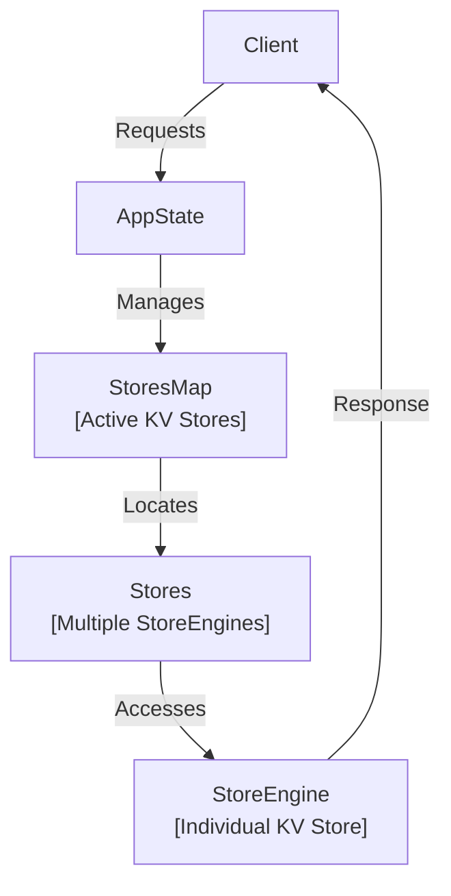
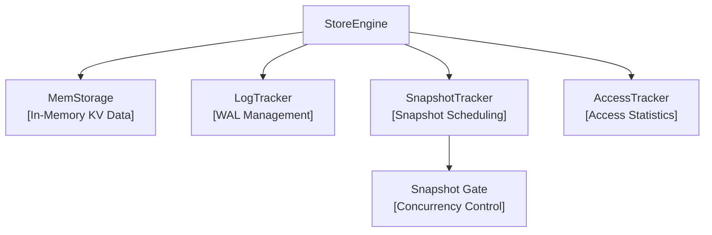
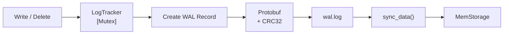
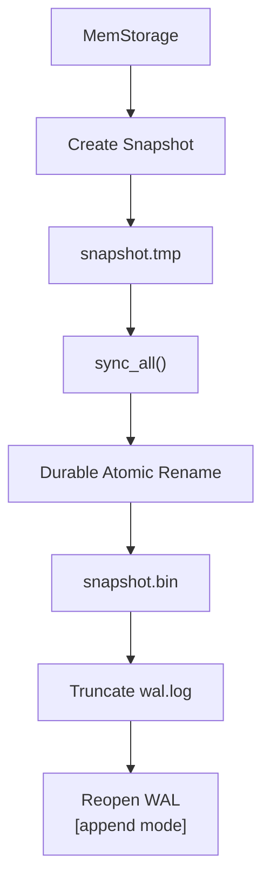
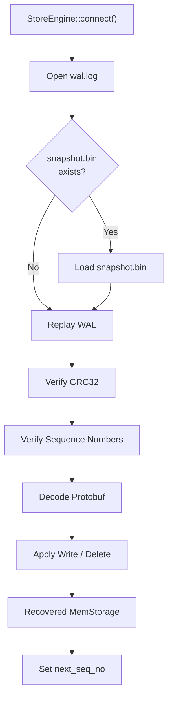
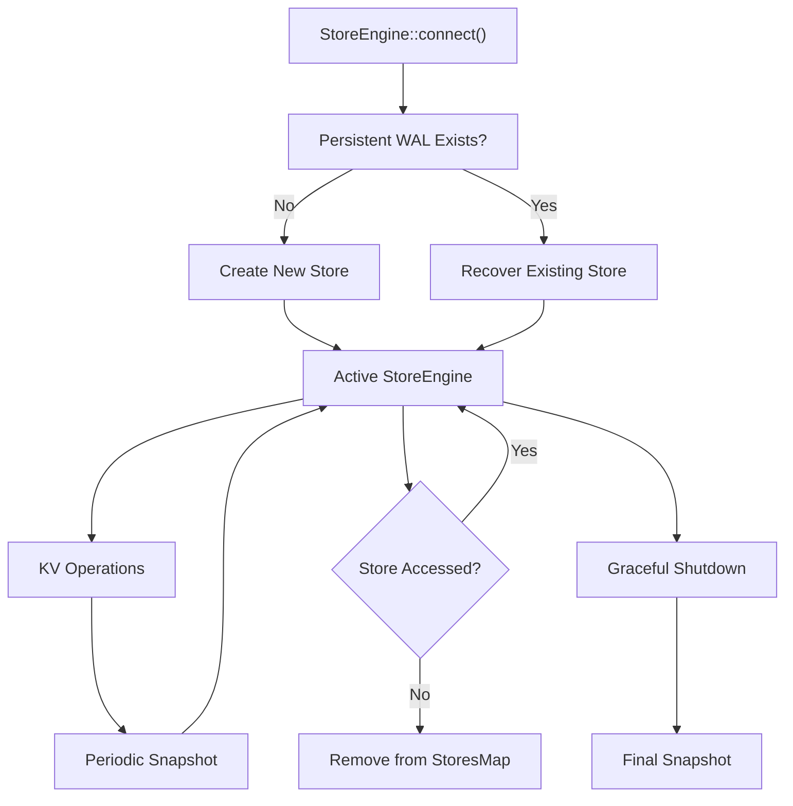
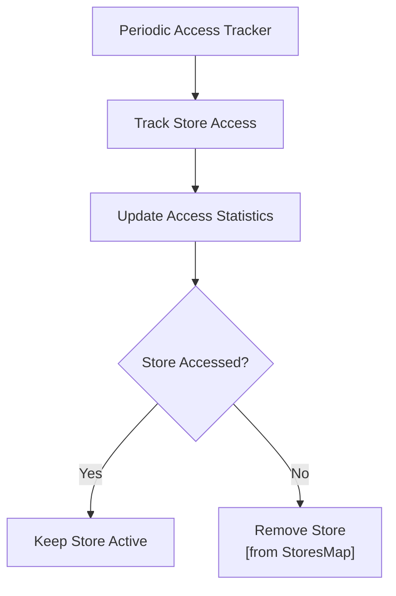

# Multithreaded KV Store

A **Rust-based, multithreaded key-value storage engine** designed as a foundation for building a future distributed KV store.

The current implementation focuses on a reliable **single-node storage engine** with concurrent access, write-ahead logging, snapshots, crash recovery, and store lifecycle management.

---

## Table of Contents

- [Current Capabilities](#current-capabilities)
- [Architecture](#architecture)
  - [High-Level Architecture](#high-level-architecture)
  - [StoreEngine](#storeengine)
  - [StoreEngine Components](#storeengine-components)
  - [Persistence Layout](#persistence-layout)
- [Operations](#operations)
  - [Supported Operations](#supported-operations)
  - [Write](#write)
  - [Read](#read)
  - [Delete](#delete)
  - [Fetch All](#fetch-all)
  - [Case Sensitivity](#case-sensitivity)
- [Write-Ahead Log](#write-ahead-log)
  - [Why WAL](#why-wal)
  - [Write Path](#write-path)
  - [WAL Record Format](#wal-record-format)
  - [Sequence Numbers](#sequence-numbers)
  - [WAL Integrity](#wal-integrity)
  - [WAL Lifecycle](#wal-lifecycle)
- [Snapshots](#snapshots)
  - [Snapshot Trigger](#snapshot-trigger)
  - [Snapshot Pipeline](#snapshot-pipeline)
  - [Snapshot Procedure](#snapshot-procedure)
  - [Durable Snapshot Replacement](#durable-snapshot-replacement)
  - [Snapshot and WAL](#snapshot-and-wal)
- [Crash Recovery](#crash-recovery)
  - [Recovery Flow](#recovery-flow)
  - [Recovery With a Snapshot](#recovery-with-a-snapshot)
  - [Recovery Without a Snapshot](#recovery-without-a-snapshot)
  - [WAL Validation During Recovery](#wal-validation-during-recovery)
  - [Recovered Sequence Number](#recovered-sequence-number)
- [Concurrency Model](#concurrency-model)
  - [Synchronization Components](#synchronization-components)
  - [Snapshot Gate](#snapshot-gate)
  - [Read Operations](#read-operations)
  - [Write / Delete Operations](#write--delete-operations)
  - [Snapshot / Shutdown](#snapshot--shutdown)
- [Store Lifecycle](#store-lifecycle)
  - [Store Creation](#store-creation)
  - [Normal Operation](#normal-operation)
  - [Access Tracking](#access-tracking)
  - [Store Eviction](#store-eviction)
  - [Graceful Shutdown](#graceful-shutdown)
- [Quick Start](#quick-start)
- [Project Structure](#project-structure)
- [Current Status](#current-status)
- [Roadmap](#roadmap)
- [Design Goals](#design-goals)
- [License](#license)

---

## Current Capabilities

- Concurrent key-value operations
- In-memory KV storage
- Write-Ahead Logging (WAL)
- Protocol Buffers for operation serialization
- CRC32 WAL integrity verification
- Sequence-number-based ordering and recovery
- Periodic snapshots
- Crash recovery from snapshots and WAL
- Durable snapshot replacement
- WAL truncation and reopening
- Store access tracking and inactive-store eviction
- Graceful shutdown

---

# Architecture

## High-Level Architecture

The application maintains a collection of active `StoreEngine` instances. Each `StoreEngine` represents an individual KV store.



## StoreEngine

Each `StoreEngine` manages the complete lifecycle of one KV store.



## StoreEngine Components

### MemStorage

`MemStorage` maintains the current KV state in memory.

It contains:

- the latest sequence number
- the KV `HashMap`

### LogTracker

`LogTracker` manages WAL-related state for a store.

It contains:

- the WAL file path
- the next sequence number
- the currently opened WAL `File`

WAL-producing operations acquire the `LogTracker` mutex so their WAL writes and sequence assignment are serialized.

### SnapshotTracker

`SnapshotTracker` controls snapshot scheduling.

It maintains the snapshot threshold and notification state used by the background snapshot task.

When the configured sequence threshold is reached, it marks the snapshot as due and notifies the snapshot task.

### AccessTracker

`AccessTracker` records store activity.

It tracks access statistics that are periodically evaluated for memory-management decisions.

### Snapshot Gate

The snapshot gate is an `RwLock<()>` used to coordinate normal operations with snapshot creation and graceful shutdown.

- Reads use the read side of the gate.
- Write/delete operations use the read side of the gate.
- Snapshot/shutdown uses the write side of the gate.

---

## Persistence Layout

Each store maintains its persistent data under its project directory:

```text
projects/
└── <kv_store_name>/
    ├── wal/
    │   └── wal.log
    └── snapshot/
        ├── snapshot.tmp
        └── snapshot.bin
```

- `wal.log` contains persisted operations since the last snapshot.
- `snapshot.bin` contains the latest materialized KV state.
- `snapshot.tmp` is used while constructing a new snapshot.

---

# Operations

## Supported Operations

The storage engine currently supports:

- `Write`
- `Read`
- `Delete`
- `Fetch All`

Operation keywords are **case-insensitive**.

Keys and values are **case-sensitive**.

## Write

### Syntax

```text
Write <key> = <value>
```

### Example

```text
Write name = Amey
```

A write stores the supplied value under the specified key.

## Read

### Syntax

```text
Read <key>
```

### Example

```text
Read name
```

A successful read returns the corresponding key-value pair. If the key does not exist, no value is returned.

## Delete

### Syntax

```text
Delete <key>
```

### Example

```text
Delete name
```

If the key exists, it is removed.

## Fetch All

```text
Fetch All
```

Returns the current in-memory KV state.

## Case Sensitivity

Operation keywords are case-insensitive:

```text
write name = Amey
WRITE name = Amey
Write name = Amey
```

Keys are case-sensitive:

```text
name
Name
NAME
```

are distinct keys.

Values are also preserved with their original case.

---

# Write-Ahead Log

The Write-Ahead Log provides the persistence mechanism for state-changing KV operations.

The main rule is:

> **Persist the WAL record before modifying the in-memory state.**

## Why WAL?

The in-memory `HashMap` is not durable by itself.

The WAL provides a persistent record of state-changing operations so that the KV state can be reconstructed after a process restart or crash.

## Write Path



## WAL Write Procedure

A write/delete operation follows this sequence:

1. Acquire the snapshot gate's read lock.
2. Acquire the `LogTracker` mutex.
3. Assign the current sequence number.
4. Construct the protobuf WAL record.
5. Encode the WAL payload.
6. Calculate CRC32 over the payload.
7. Build the binary WAL record.
8. Append the record to `wal.log`.
9. Call `sync_data()`.
10. Update `MemStorage`.
11. Increment the next sequence number.
12. Check whether the snapshot threshold has been reached.

## WAL Record Format

Each record is stored as:

```text
+----------------------+
| Payload Length       | 8 bytes
+----------------------+
| CRC32                | 4 bytes
+----------------------+
| Protobuf Payload     | Variable
+----------------------+
```

### Payload Length

An 8-byte little-endian integer stores the size of the protobuf payload.

### CRC32

A 4-byte little-endian CRC32 value protects the payload against corruption.

### Protobuf Payload

The payload contains the encoded WAL protobuf message, including:

- sequence number
- KV operation

## Sequence Numbers

Every WAL-producing operation receives a monotonically increasing sequence number.

Sequence numbers are used to:

- preserve operation ordering
- identify the latest persisted state
- determine which WAL operations must be replayed after a snapshot
- detect missing or out-of-order WAL records during recovery

## WAL Integrity

During WAL reading, the storage engine:

1. Reads the payload length.
2. Reads the stored CRC32.
3. Reads the payload.
4. Calculates CRC32 over the payload.
5. Compares calculated and stored values.
6. Decodes the protobuf payload.

A CRC32 mismatch causes recovery to fail rather than silently applying corrupted state.

## WAL Lifecycle

The WAL is opened in append mode for normal operation.

During snapshot creation, the WAL is truncated after the new snapshot has been safely persisted.

```text
snapshot.bin
     ↓
truncate wal.log
     ↓
sync_all()
     ↓
reopen wal.log [append mode]
```

The existing WAL `File` is removed from `LogTracker` before truncation so the file can be reopened cleanly.

---

# Snapshots

Snapshots periodically materialize the current in-memory KV state into a durable snapshot file.

They reduce the amount of WAL that must be replayed during recovery.

## Snapshot Trigger

`SnapshotTracker` monitors the next sequence number.

When the configured snapshot window is reached, the tracker marks the snapshot as due and notifies the background snapshot task.

The current default configuration is:

```text
65,000 operations
```

## Snapshot Pipeline



## Snapshot Procedure

1. Acquire the snapshot gate's write lock.
2. Read the current in-memory state.
3. Construct a snapshot containing the latest sequence number and KV data.
4. Encode the snapshot using Protocol Buffers.
5. Create `snapshot.tmp`.
6. Write the encoded snapshot to the temporary file.
7. Call `sync_all()` on the temporary file.
8. Atomically replace `snapshot.bin`.
9. Make the rename durable.
10. Truncate `wal.log`.
11. Synchronize the truncated WAL.
12. Reopen the WAL in append mode.
13. Store the reopened WAL file back into `LogTracker`.

## Temporary Snapshot

The new snapshot is first written to:

```text
snapshot.tmp
```

The existing `snapshot.bin` is not overwritten while the new snapshot is being constructed.

## Durable Snapshot Replacement

The implementation uses platform-specific durable rename behavior.

On Windows, the implementation uses `MoveFileExW` with replacement and write-through behavior.

On Unix, the implementation uses filesystem rename followed by directory synchronization.

The goal is to make the replacement of `snapshot.bin` durable rather than relying only on the file contents being synchronized.

## Snapshot and WAL

Once the new `snapshot.bin` has been safely installed, the WAL can be truncated because operations represented by the snapshot no longer need to remain in the WAL.

The WAL is then reopened in append mode for subsequent operations.

---

# Crash Recovery

Crash recovery reconstructs the latest KV state when a `StoreEngine` starts.

The recovery process uses the snapshot, if available, together with the WAL.

## Recovery Flow



## Recovery With a Snapshot

If `snapshot.bin` exists:

```text
snapshot.bin
     ↓
Load snapshot state
     ↓
Read last_sequence
     ↓
Replay newer WAL records
     ↓
Verify WAL records
     ↓
Apply newer operations
     ↓
Recovered state
```

Operations already represented by the snapshot are not replayed again.

## Recovery Without a Snapshot

If `snapshot.bin` does not exist:

```text
wal.log
   ↓
Read WAL records
   ↓
Verify CRC32
   ↓
Validate sequence numbers
   ↓
Decode protobuf
   ↓
Apply Write / Delete
   ↓
Recovered state
```

## WAL Validation During Recovery

Recovery validates the WAL before applying operations.

### Record completeness

Each WAL record must contain:

1. payload length
2. CRC32
3. complete payload

### CRC32 validation

The stored CRC32 is compared with a newly calculated CRC32 of the payload.

A mismatch causes recovery to fail.

### Sequence validation

After loading a snapshot, recovery expects WAL sequence numbers to continue from:

```text
snapshot.last_sequence + 1
```

A missing or out-of-order sequence number causes recovery to fail.

### Protobuf validation

The WAL payload must decode successfully into the expected protobuf WAL message.

### Operation validation

Only state-changing operations are valid for WAL replay:

- Write
- Delete

Read operations do not belong in the WAL because they do not change persistent state.

## Recovered Sequence Number

After recovery, the next WAL sequence number is initialized from the latest recovered sequence:

```text
next_seq_no = last_sequence + 1
```

This prevents sequence-number reuse.

---

# Concurrency Model

The storage engine uses separate synchronization mechanisms for different responsibilities rather than protecting the entire `StoreEngine` with one global mutex.

## Synchronization Components

| Component | Synchronization | Responsibility |
|---|---|---|
| `StoresMap` | `RwLock` | Protect active store collection |
| `MemStorage` | `RwLock` | Concurrent KV reads and exclusive KV mutations |
| `LogTracker` | Tokio `Mutex` | Serialize WAL-producing operations |
| `AccessTracker` | `Mutex` | Protect access statistics |
| `SnapshotTracker` | Atomics + `Notify` | Snapshot scheduling state |
| Snapshot Gate | `RwLock<()>` | Coordinate normal operations with snapshots |

## Snapshot Gate

The snapshot gate separates normal operations from exclusive snapshot/shutdown work.

```text
                 Snapshot Gate
                    [RwLock]
                       │
          ┌────────────┼────────────┐
          │            │            │
       Read Lock    Read Lock    Write Lock
          │            │            │
        Reads      Write/Delete  Snapshot
                       │
                       ↓
                 LogTracker
                  [Mutex]
                       │
                       ↓
                 MemStorage
                  [RwLock]
```

The key rule is:

- Normal reads use the read side of the gate.
- Write/delete operations use the read side of the gate.
- Snapshot/shutdown uses the write side of the gate.

## Read Operations

Multiple read operations can access in-memory storage concurrently.

```text
Read Operation
      ↓
Snapshot Gate [Read Lock]
      ↓
MemStorage [Read Lock]
```

## Write / Delete Operations

State-changing operations use two levels of synchronization:

```text
Write / Delete
      ↓
Snapshot Gate [Read Lock]
      ↓
LogTracker [Mutex]
      ↓
WAL
      ↓
MemStorage [Write Lock]
```

The `LogTracker` mutex serializes WAL-producing operations, providing deterministic ordering for sequence numbers and WAL appends.

## Snapshot / Shutdown

Snapshot creation and graceful shutdown acquire the exclusive side of the snapshot gate:

```text
Snapshot / Shutdown
        ↓
Snapshot Gate [Write Lock]
        ↓
Snapshot Persistence
        ↓
WAL Truncation
        ↓
WAL Reopen
```

While the write lock is held, normal operations cannot acquire the gate's read lock.

---

# Store Lifecycle

The lifecycle describes how an individual `StoreEngine` is created, recovered, used, potentially evicted, and shut down.

## Lifecycle Overview



## Store Creation

`StoreEngine::connect()` prepares the store's persistent directories and opens or creates its WAL.

If no persistent state exists, a new store starts with an empty in-memory state.

If persistent state exists, the engine enters recovery.

## Normal Operation

During normal operation:

```text
Active Store
     ↓
Read / Write / Delete
     ↓
MemStorage
     +
WAL
```

State-changing operations are persisted through the WAL before modifying the in-memory state.

## Access Tracking

The application periodically evaluates access statistics for active stores.

The default access-tracking interval is:

```text
120 seconds
```



## Store Eviction

Inactive stores can be removed from the active `StoresMap`.

Their persistent state remains on disk:

```text
projects/
└── <kv_store_name>/
    ├── wal/
    │   └── wal.log
    └── snapshot/
        └── snapshot.bin
```

A store can therefore be reconstructed later using its persistent state.

## Graceful Shutdown

During application shutdown:

1. Stop the access tracker.
2. Collect active `StoreEngine` instances.
3. Perform a final snapshot for each store.
4. Persist the snapshot.
5. Truncate and reopen the WAL.

```text
Application Shutdown
        ↓
Stop Access Tracker
        ↓
Collect Active Stores
        ↓
Final Snapshot
        ↓
Persist snapshot.bin
        ↓
Truncate WAL
        ↓
Process Exit
```

---

# Quick Start

## Build

Make sure Rust and Cargo are installed.

```bash
cargo build
```

The build process generates Rust types from the protobuf schema.

## Run

```bash
cargo run
```

The current server listens on:

```text
127.0.0.1:7878
```

---

# Project Structure

```text
multithreaded_kv_store/
│
├── README.md
│
├── src/
│   ├── main.rs              # Server entry point
│   └── lib.rs               # Storage engine and core logic
│
├── proto/
│   └── kvstore.proto        # Protocol Buffer definitions
│
├── build.rs                 # Protobuf code generation
│
├── pages/                   # HTML pages used by the server
│
├── projects/                # Runtime KV store data
│   └── <store>/
│       ├── wal/
│       └── snapshot/
│
└── Cargo.toml
```

---

# Current Status

The project has progressed beyond the initial WAL-only prototype and currently provides the core mechanisms of a durable local KV storage engine.

- [x] In-memory KV storage
- [x] Read / write / delete operations
- [x] WAL
- [x] Protobuf serialization
- [x] CRC32 integrity checking
- [x] Sequence numbers
- [x] Snapshot creation
- [x] Snapshot threshold tracking
- [x] Snapshot + WAL recovery
- [x] Durable snapshot replacement
- [x] WAL truncation and reopening
- [x] Snapshot concurrency gate
- [x] Access tracking
- [x] Inactive-store eviction
- [x] Graceful shutdown

The project is still an evolving systems project rather than a production database.

---

# Roadmap

The long-term goal is to extend the local storage engine toward a distributed KV store.

1. Structured client/server KV protocol
2. Node-to-node communication
3. Cluster membership
4. Replication
5. Leader-based coordination
6. Distributed request routing
7. Failure detection
8. Fault-tolerant recovery
9. Distributed consistency mechanisms

The current WAL, snapshot, recovery, and concurrency mechanisms form the local storage foundation for these future distributed components.

---

# Design Goals

The project focuses on implementing storage-engine concepts directly rather than simply wrapping an existing database.

Key areas include:

- Concurrent data access
- Durable writes
- Write-ahead logging
- Data integrity
- Crash recovery
- Snapshotting
- Sequence-number ordering
- Atomic file replacement
- Filesystem durability
- Memory management
- Concurrency control

---

# License

No license has been specified yet.
