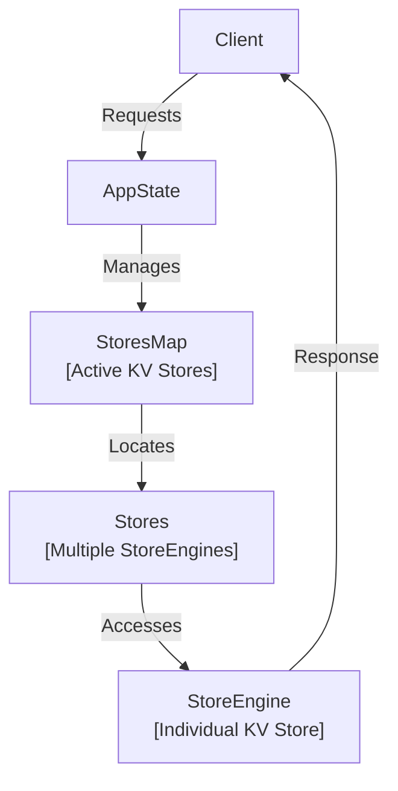
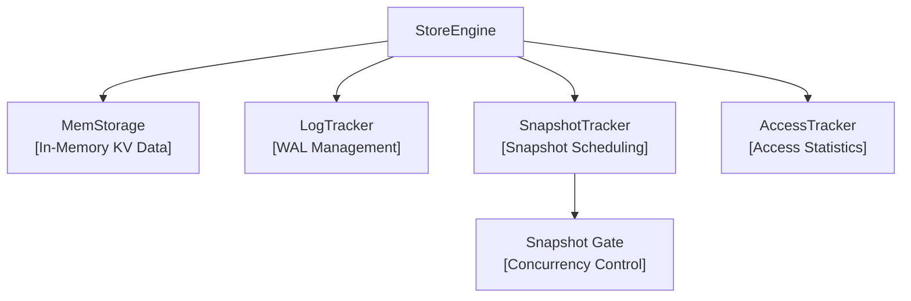
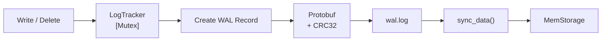
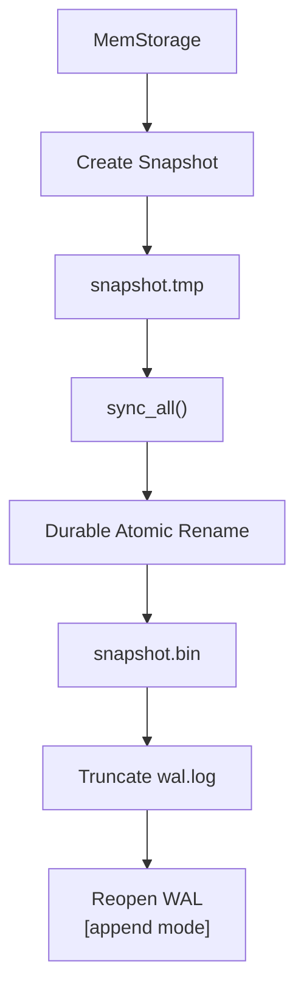
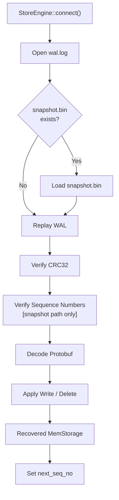
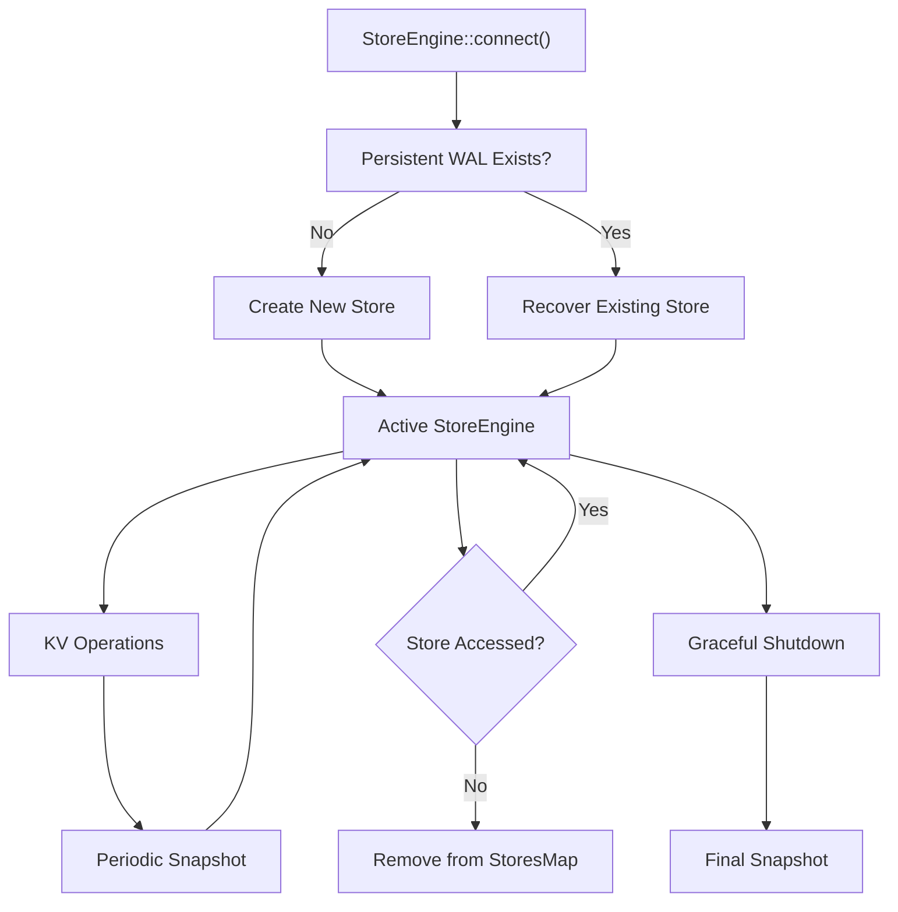
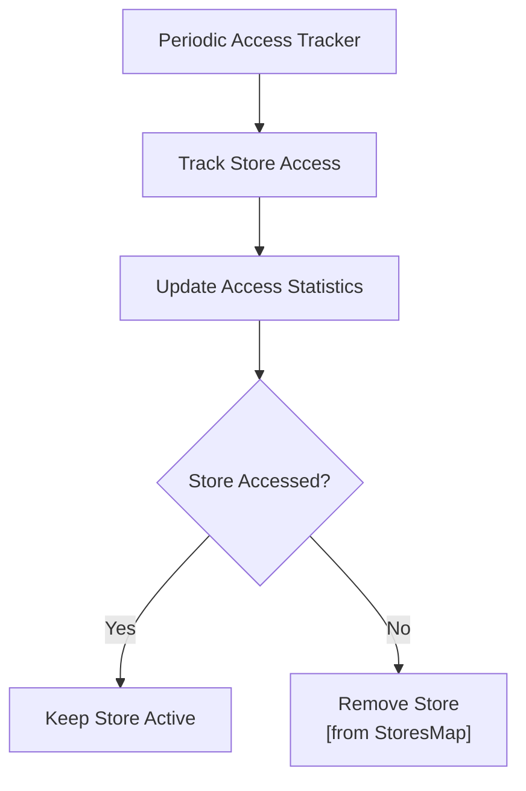

# Multithreaded KV Store

A **Rust-based, multithreaded key-value storage engine** designed as a foundation for building a future distributed KV store.

The current implementation is a reliable **single-node storage engine** with concurrent access, a write-ahead log, snapshots, crash recovery, store lifecycle management, and an HTTP API. Every write is fsynced to the WAL before it is acknowledged.

---

## Table of Contents

- [Current Capabilities](#current-capabilities)
- [Quick Start](#quick-start)
- [HTTP API](#http-api)
- [Architecture](#architecture)
  - [High-Level Architecture](#high-level-architecture)
  - [Library API](#library-api)
  - [StoreEngine](#storeengine)
  - [StoreEngine Components](#storeengine-components)
  - [Persistence Layout](#persistence-layout)
- [Operations](#operations)
  - [Supported Operations](#supported-operations)
  - [Write](#write)
  - [Read](#read)
  - [Delete](#delete)
  - [Paginated Fetch](#paginated-fetch)
  - [Case Sensitivity](#case-sensitivity)
- [Write-Ahead Log](#write-ahead-log)
  - [Why WAL](#why-wal)
  - [Write Path](#write-path)
  - [WAL Record Format](#wal-record-format)
  - [Sequence Numbers](#sequence-numbers)
  - [WAL Integrity](#wal-integrity)
  - [WAL Lifecycle](#wal-lifecycle)
- [Snapshots](#snapshots)
  - [Snapshot Trigger](#snapshot-trigger)
  - [Snapshot Pipeline](#snapshot-pipeline)
  - [Snapshot Procedure](#snapshot-procedure)
  - [Durable Snapshot Replacement](#durable-snapshot-replacement)
  - [Snapshot and WAL](#snapshot-and-wal)
- [Crash Recovery](#crash-recovery)
  - [Recovery Flow](#recovery-flow)
  - [Recovery With a Snapshot](#recovery-with-a-snapshot)
  - [Recovery Without a Snapshot](#recovery-without-a-snapshot)
  - [WAL Validation During Recovery](#wal-validation-during-recovery)
  - [Recovered Sequence Number](#recovered-sequence-number)
- [Concurrency Model](#concurrency-model)
  - [Synchronization Components](#synchronization-components)
  - [Snapshot Gate](#snapshot-gate)
  - [Read Operations](#read-operations)
  - [Write / Delete Operations](#write--delete-operations)
  - [Paged Reads](#paged-reads)
  - [Snapshot / Shutdown](#snapshot--shutdown)
- [Store Lifecycle](#store-lifecycle)
  - [Store Creation](#store-creation)
  - [Normal Operation](#normal-operation)
  - [Access Tracking](#access-tracking)
  - [Store Eviction](#store-eviction)
  - [Store Deletion](#store-deletion)
  - [Graceful Shutdown](#graceful-shutdown)
- [Testing](#testing)
- [Benchmarks](#benchmarks)
- [Known Limitations](#known-limitations)
- [Project Structure](#project-structure)
- [Current Status](#current-status)
- [Roadmap](#roadmap)
- [Design Goals](#design-goals)
- [License](#license)

---

## Current Capabilities

- Concurrent key-value operations
- In-memory KV storage
- Write-Ahead Logging (WAL) with an fsync before every acknowledged write
- Protocol Buffers for operation serialization
- CRC32 WAL integrity verification
- Sequence-number-based ordering and recovery
- Periodic snapshots
- Crash recovery from snapshots and WAL
- Durable snapshot replacement
- WAL truncation and reopening
- HTTP API (axum + tokio) with paginated reads
- Store access tracking and inactive-store eviction (opt-in)
- Graceful shutdown
- Integration test suite (36 tests) and k6 load tests

---

# Quick Start

## Build

Make sure Rust and Cargo are installed.

```bash
cargo build
```

The build process generates Rust types from the protobuf schema.

## Run

```bash
cargo run --release
```

The server listens on:

```text
127.0.0.1:7878
```

Use `--release` for anything performance-related; debug builds are much slower.

## Try it

On Windows PowerShell, use `curl.exe` instead of `curl`.

```bash
# create (or reopen) a store
curl http://127.0.0.1:7878/create_kv/demo

# write a key (form-encoded body)
curl -X POST http://127.0.0.1:7878/write \
  -d "key=City" -d "value=Mumbai" -d "kv_store_name=demo"

# read it back
curl http://127.0.0.1:7878/demo/read/City

# list entries, 100 per page
curl http://127.0.0.1:7878/pages/demo/0/100

# delete it
curl http://127.0.0.1:7878/demo/delete/City
```

## Test

```bash
cargo test
```

See [Testing](#testing) and [Benchmarks](#benchmarks) for details.

---

# HTTP API

| Method | Route | Purpose |
|---|---|---|
| `GET` | `/` | Health check |
| `GET` | `/home` | HTML home page |
| `GET` | `/create_kv/{kv_store_name}` | Create a store, or reopen it from disk (snapshot window: 65,000 operations) |
| `POST` | `/write` | Write a key. Body is `application/x-www-form-urlencoded` with `key`, `value`, `kv_store_name` |
| `GET` | `/{kv_store_name}/read/{key}` | Read a key |
| `GET` | `/{kv_store_name}/delete/{key}` | Delete a key |
| `GET` | `/pages/{kv_store_name}` | First page: offset 0, limit 100 |
| `GET` | `/pages/{kv_store_name}/{offset}/{limit}` | One page of entries. `limit` must be 1 to 100 |

## Responses

**Every handler returns HTTP 200**, including for failures. Check the `operation_status` field in the JSON body to see whether the operation succeeded.

Read, write and delete:

```json
{
  "status": "ok",
  "message": "...",
  "kv_store_name": "demo",
  "operation_status": true,
  "kv_output": { "key": "City", "value": "Mumbai" }
}
```

When the store or key does not exist, `operation_status` is `false` and `kv_output` holds empty strings. When the engine returns an error, an `error` field is added.

Paged reads return a two-element array: the page (a map) and the total number of entries in the store.

```json
{
  "status": "ok",
  "message": "...",
  "kv_store_name": "demo",
  "operation_status": true,
  "kv_output": [ { "City": "Mumbai", "Name": "Amey" }, 2 ]
}
```

An invalid `limit` or a missing store returns `operation_status: false` with an `error` field.

---

# Architecture

## High-Level Architecture

The application maintains a collection of active `StoreEngine` instances. Each `StoreEngine` represents an individual KV store.



## Library API

`AppState` is the entry point of the library. The HTTP handlers and the integration tests both go through it.

| Method | Purpose |
|---|---|
| `connect_store(name, snapshot_window_size)` | Create a store, or reopen it from its WAL and snapshot. Replaces the active engine if one exists |
| `store_exists(name)` | Check whether a store is active |
| `write_in_store(name, key, value)` | Durable write |
| `read_from_store(name, key)` | Read |
| `delete_from_store(name, key)` | Durable delete |
| `fetch_page_from_store(name, offset, limit)` | One page of entries plus the store's total entry count. `limit` must be 1 to 100 |
| `execute_query(name, query)` | Run a textual operation such as `Write name = Amey` |
| `delete_store(name)` | Move the store's directory into `deleted/` |
| `cleanup_deleted_folder()` | Remove the `deleted/` folder |
| `spawn_access_tracker(interval)` / `stop_access_tracker()` | Start or stop the idle-store tracker |
| `graceful_shutdown()` | Final snapshot for every active store |

## StoreEngine

Each `StoreEngine` manages the complete lifecycle of one KV store.



## StoreEngine Components

### MemStorage

`MemStorage` maintains the current KV state in memory.

It contains:

- the latest sequence number
- the KV `HashMap`

### LogTracker

`LogTracker` manages WAL-related state for a store.

It contains:

- the WAL file path
- the next sequence number
- the currently opened WAL `File`

WAL-producing operations acquire the `LogTracker` mutex so their WAL writes and sequence assignment are serialized.

### SnapshotTracker

`SnapshotTracker` controls snapshot scheduling.

It maintains the snapshot threshold and notification state used by the background snapshot task.

When the configured sequence threshold is reached, it marks the snapshot as due and notifies the snapshot task.

### AccessTracker

`AccessTracker` records store activity.

It tracks access statistics that are periodically evaluated for memory-management decisions.

### Snapshot Gate

The snapshot gate is an `RwLock<()>` used to coordinate normal operations with snapshot creation and graceful shutdown.

- Reads use the read side of the gate.
- Write/delete operations use the read side of the gate.
- Snapshot/shutdown uses the write side of the gate.

---

## Persistence Layout

Each store maintains its persistent data under its project directory:

```text
projects/
└── <kv_store_name>/
    ├── wal/
    │   └── wal.log
    └── snapshot/
        ├── snapshot.tmp
        └── snapshot.bin
```

- `wal.log` contains persisted operations since the last snapshot.
- `snapshot.bin` contains the latest materialized KV state.
- `snapshot.tmp` is used while constructing a new snapshot.

---

# Operations

## Supported Operations

The storage engine supports:

- `Write`
- `Read`
- `Delete`
- Paginated fetch (see [Paginated Fetch](#paginated-fetch))

`Write`, `Read` and `Delete` can be issued as textual queries through `AppState::execute_query`, or through the typed methods and HTTP routes.

Operation keywords are **case-insensitive**.

Keys and values are **case-sensitive**.

In the textual syntax, the query is split on single spaces, so keys and values are single tokens without spaces. The typed methods and the HTTP `/write` route have no such restriction.

## Write

### Syntax

```text
Write <key> = <value>
```

### Example

```text
Write name = Amey
```

A write stores the supplied value under the specified key.

## Read

### Syntax

```text
Read <key>
```

### Example

```text
Read name
```

A successful read returns the corresponding key-value pair. If the key does not exist, no value is returned.

## Delete

### Syntax

```text
Delete <key>
```

### Example

```text
Delete name
```

If the key exists, it is removed.

## Paginated Fetch

The engine does not offer a "fetch everything" operation. A full dump cloned the whole in-memory map while holding the read lock, which grows with the store and can block writers. Entries are read one bounded page at a time instead.

```text
fetch_page_from_store(store, offset, limit) -> (page, total_entries)
GET /pages/{store}/{offset}/{limit}
```

- `offset` is the number of entries to skip. `0` is the first page.
- `limit` is the page size and must be between **1 and 100**.
- `total_entries` is the number of entries in the whole store.
- An `offset` at or past the end returns an empty page.
- The page is built under a single read lock, so it is internally consistent.

To read everything, request pages with `offset += limit` until `offset >= total_entries`. Do this while writes are stopped: `HashMap` iteration order is arbitrary and can change when the map is modified, so pages fetched during concurrent writes may repeat or miss entries.

## Case Sensitivity

Operation keywords are case-insensitive:

```text
write name = Amey
WRITE name = Amey
Write name = Amey
```

Keys are case-sensitive:

```text
name
Name
NAME
```

are distinct keys.

Values are also preserved with their original case.

---

# Write-Ahead Log

The Write-Ahead Log provides the persistence mechanism for state-changing KV operations.

The main rule is:

> **Persist the WAL record before modifying the in-memory state.**

## Why WAL?

The in-memory `HashMap` is not durable by itself.

The WAL provides a persistent record of state-changing operations so that the KV state can be reconstructed after a process restart or crash.

## Write Path



## WAL Write Procedure

A write/delete operation follows this sequence:

1. Acquire the snapshot gate's read lock.
2. Acquire the `LogTracker` mutex.
3. Assign the current sequence number.
4. Construct the protobuf WAL record.
5. Encode the WAL payload.
6. Calculate CRC32 over the payload.
7. Build the binary WAL record.
8. Append the record to `wal.log`.
9. Call `sync_data()`.
10. Update `MemStorage`.
11. Increment the next sequence number.
12. Check whether the snapshot threshold has been reached.

## WAL Record Format

Each record is stored as:

```text
+----------------------+
| Payload Length       | 8 bytes
+----------------------+
| CRC32                | 4 bytes
+----------------------+
| Protobuf Payload     | Variable
+----------------------+
```

### Payload Length

An 8-byte little-endian integer stores the size of the protobuf payload.

### CRC32

A 4-byte little-endian CRC32 value protects the payload against corruption.

### Protobuf Payload

The payload contains the encoded WAL protobuf message, including:

- sequence number
- KV operation

## Sequence Numbers

Every WAL-producing operation receives a monotonically increasing sequence number.

Sequence numbers are used to:

- preserve operation ordering
- identify the latest persisted state
- determine which WAL operations must be replayed after a snapshot
- detect missing or out-of-order WAL records when recovering on top of a snapshot

## WAL Integrity

During WAL reading, the storage engine:

1. Reads the payload length.
2. Reads the stored CRC32.
3. Reads the payload.
4. Calculates CRC32 over the payload.
5. Compares calculated and stored values.
6. Decodes the protobuf payload.

A CRC32 mismatch causes recovery to fail rather than silently applying corrupted state. An integration test flips a byte in the WAL and asserts that recovery is rejected.

## WAL Lifecycle

The WAL is opened in append mode for normal operation.

During snapshot creation, the WAL is truncated after the new snapshot has been safely persisted.

```text
snapshot.bin
     ↓
truncate wal.log
     ↓
sync_all()
     ↓
reopen wal.log [append mode]
```

The existing WAL `File` is removed from `LogTracker` before truncation so the file can be reopened cleanly.

---

# Snapshots

Snapshots periodically materialize the current in-memory KV state into a durable snapshot file.

They reduce the amount of WAL that must be replayed during recovery.

## Snapshot Trigger

`SnapshotTracker` monitors the next sequence number.

When the configured snapshot window is reached, the tracker marks the snapshot as due and notifies the background snapshot task.

The `/create_kv` route configures:

```text
65,000 operations
```

## Snapshot Pipeline



## Snapshot Procedure

1. Acquire the snapshot gate's write lock.
2. Read the current in-memory state.
3. Construct a snapshot containing the latest sequence number and KV data.
4. Encode the snapshot using Protocol Buffers.
5. Create `snapshot.tmp`.
6. Write the encoded snapshot to the temporary file.
7. Call `sync_all()` on the temporary file.
8. Atomically replace `snapshot.bin`.
9. Make the rename durable.
10. Truncate `wal.log`.
11. Synchronize the truncated WAL.
12. Reopen the WAL in append mode.
13. Store the reopened WAL file back into `LogTracker`.

## Temporary Snapshot

The new snapshot is first written to:

```text
snapshot.tmp
```

The existing `snapshot.bin` is not overwritten while the new snapshot is being constructed.

## Durable Snapshot Replacement

The implementation uses platform-specific durable rename behavior.

On Windows, the implementation uses `MoveFileExW` with replacement and write-through behavior.

On Unix, the implementation uses filesystem rename followed by directory synchronization.

The goal is to make the replacement of `snapshot.bin` durable rather than relying only on the file contents being synchronized.

## Snapshot and WAL

Once the new `snapshot.bin` has been safely installed, the WAL can be truncated because operations represented by the snapshot no longer need to remain in the WAL.

The WAL is then reopened in append mode for subsequent operations.

---

# Crash Recovery

Crash recovery reconstructs the latest KV state when a `StoreEngine` starts.

The recovery process uses the snapshot, if available, together with the WAL.

## Recovery Flow



## Recovery With a Snapshot

If `snapshot.bin` exists:

```text
snapshot.bin
     ↓
Load snapshot state
     ↓
Read last_sequence
     ↓
Replay newer WAL records
     ↓
Verify WAL records
     ↓
Apply newer operations
     ↓
Recovered state
```

Operations already represented by the snapshot are not replayed again.

## Recovery Without a Snapshot

If `snapshot.bin` does not exist:

```text
wal.log
   ↓
Read WAL records
   ↓
Verify CRC32
   ↓
Decode protobuf
   ↓
Apply Write / Delete
   ↓
Recovered state
```

On this path the engine checks record completeness, CRC32, protobuf decoding and operation type. It does not yet verify that sequence numbers are contiguous (see [Known Limitations](#known-limitations)).

## WAL Validation During Recovery

Recovery validates the WAL before applying operations.

### Record completeness

Each WAL record must contain:

1. payload length
2. CRC32
3. complete payload

### CRC32 validation

The stored CRC32 is compared with a newly calculated CRC32 of the payload.

A mismatch causes recovery to fail.

### Sequence validation

After loading a snapshot, recovery expects WAL sequence numbers to continue from:

```text
snapshot.last_sequence + 1
```

A missing or out-of-order sequence number causes recovery to fail.

### Protobuf validation

The WAL payload must decode successfully into the expected protobuf WAL message.

### Operation validation

Only state-changing operations are valid for WAL replay:

- Write
- Delete

Read operations do not belong in the WAL because they do not change persistent state.

## Recovered Sequence Number

After recovery, the next WAL sequence number is initialized from the latest recovered sequence:

```text
next_seq_no = last_sequence + 1
```

This prevents sequence-number reuse. An integration test writes, recovers, writes again and recovers a second time to confirm the sequence continues correctly.

---

# Concurrency Model

The storage engine uses separate synchronization mechanisms for different responsibilities rather than protecting the entire `StoreEngine` with one global mutex.

## Synchronization Components

| Component | Synchronization | Responsibility |
|---|---|---|
| `StoresMap` | `RwLock` | Protect active store collection |
| `MemStorage` | `RwLock` | Concurrent KV reads and exclusive KV mutations |
| `LogTracker` | Tokio `Mutex` | Serialize WAL-producing operations |
| `AccessTracker` | `Mutex` | Protect access statistics |
| `SnapshotTracker` | Atomics + `Notify` | Snapshot scheduling state |
| Snapshot Gate | `RwLock<()>` | Coordinate normal operations with snapshots |

## Snapshot Gate

The snapshot gate separates normal operations from exclusive snapshot/shutdown work.

```text
                 Snapshot Gate
                    [RwLock]
                       │
          ┌────────────┼────────────┐
          │            │            │
       Read Lock    Read Lock    Write Lock
          │            │            │
        Reads      Write/Delete  Snapshot
                       │
                       ↓
                 LogTracker
                  [Mutex]
                       │
                       ↓
                 MemStorage
                  [RwLock]
```

The key rule is:

- Normal reads use the read side of the gate.
- Write/delete operations use the read side of the gate.
- Snapshot/shutdown uses the write side of the gate.

## Read Operations

Multiple read operations can access in-memory storage concurrently.

```text
Read Operation
      ↓
Snapshot Gate [Read Lock]
      ↓
MemStorage [Read Lock]
```

## Write / Delete Operations

State-changing operations use two levels of synchronization:

```text
Write / Delete
      ↓
Snapshot Gate [Read Lock]
      ↓
LogTracker [Mutex]
      ↓
WAL
      ↓
MemStorage [Write Lock]
```

The `LogTracker` mutex serializes WAL-producing operations, providing deterministic ordering for sequence numbers and WAL appends.

## Paged Reads

```text
Paged Read
      ↓
MemStorage [Read Lock]
```

A paged read takes only the `MemStorage` read lock and does not take the snapshot gate. It copies at most 100 entries, so the lock is held briefly regardless of the size of the store.

## Snapshot / Shutdown

Snapshot creation and graceful shutdown acquire the exclusive side of the snapshot gate:

```text
Snapshot / Shutdown
        ↓
Snapshot Gate [Write Lock]
        ↓
Snapshot Persistence
        ↓
WAL Truncation
        ↓
WAL Reopen
```

While the write lock is held, normal operations cannot acquire the gate's read lock.

---

# Store Lifecycle

The lifecycle describes how an individual `StoreEngine` is created, recovered, used, potentially evicted, deleted, and shut down.

## Lifecycle Overview



## Store Creation

`StoreEngine::connect()` prepares the store's persistent directories and opens or creates its WAL.

If no persistent state exists, a new store starts with an empty in-memory state.

If persistent state exists, the engine enters recovery.

Connecting to a store that is already active replaces the active engine with one rebuilt from disk.

## Normal Operation

During normal operation:

```text
Active Store
     ↓
Read / Write / Delete
     ↓
MemStorage
     +
WAL
```

State-changing operations are persisted through the WAL before modifying the in-memory state.

## Access Tracking

Access tracking is opt-in. It runs when `AppState::spawn_access_tracker` is called and stops with `stop_access_tracker`.

Each store keeps an access counter that the tracker evaluates once per interval. The default interval is:

```text
120 seconds
```



## Store Eviction

Inactive stores can be removed from the active `StoresMap`.

Their persistent state remains on disk:

```text
projects/
└── <kv_store_name>/
    ├── wal/
    │   └── wal.log
    └── snapshot/
        └── snapshot.bin
```

A store can therefore be reconstructed later using its persistent state.

## Store Deletion

`AppState::delete_store` removes a store from the active map and moves its directory out of `projects/`:

```text
projects/<store_name>  →  deleted/<store_name>-HH-MM-SS-microseconds
```

The move is made durable (`MoveFileExW` with write-through on Windows, rename plus directory sync on Unix). The snapshot task for the store is shut down first. `cleanup_deleted_folder` removes the `deleted/` folder.

## Graceful Shutdown

`AppState::graceful_shutdown` performs the following:

1. Stop the access tracker.
2. Collect active `StoreEngine` instances.
3. Perform a final snapshot for each store.
4. Persist the snapshot.
5. Truncate and reopen the WAL.

```text
Application Shutdown
        ↓
Stop Access Tracker
        ↓
Collect Active Stores
        ↓
Final Snapshot
        ↓
Persist snapshot.bin
        ↓
Truncate WAL
        ↓
Process Exit
```

---

# Testing

```bash
cargo test
```

The integration suite lives in `tests/integration/` and has **36 tests**:

| File | Tests | Covers |
|---|---|---|
| `operations.rs` | 8 | write/read/update/delete, case sensitivity, textual query parser, missing-store errors |
| `pagination.rs` | 8 | page partitioning, offset 0 and past-the-end, limit bounds (1 to 100), empty and missing stores, deletes and updates, page sizes |
| `concurrency.rs` | 4 | concurrent writes to distinct keys, mixed reads/writes, same-key contention, paging during writes |
| `persistence.rs` | 6 | WAL recovery, recovery twice in a row, graceful shutdown snapshot, CRC corruption rejected, snapshot recovery, paged fetch after recovery |
| `snapshots.rs` | 2 | background snapshot trigger, paging after snapshot and reconnect |
| `store_lifecycle.rs` | 6 | create, delete, delete isolation, directory move to `deleted/`, use-after-delete errors, graceful shutdown of multiple stores |
| `access_tracker.rs` | 2 | idle-store eviction, accessed-store survival |

Tests share one `AppState` and a global lock, because they share the on-disk `projects/` directory. Each test creates a uniquely named `test_*` store and cleans it up afterwards.

---

# Benchmarks

Load tests use [k6](https://k6.io/). The script is `loadtests/kv_loadtest.js`.

## Method

The script creates a store, preloads 2,000 keys with 64-byte values, then runs four phases of 20 seconds each, 5 seconds apart, at a fixed number of concurrent clients:

| Phase | Clients | Load |
|---|---|---|
| Writes | 32 | `POST /write`, one new key per request |
| Reads | 100 | `GET /{store}/read/{key}` over the preloaded keys |
| Mixed | 64 | 80% reads, 20% writes |
| Pages | 16 | `GET /pages/{store}/{offset}/100`, offsets within the first 2,000 entries |

Each response is checked on `operation_status`, not only on the HTTP status.

## Results

Three runs, about 1.53 million requests in total, **0 failed checks**. Throughput is each phase's request count divided by its 20 seconds. Latencies are the median of the three runs.

| Phase | Throughput (req/s) | 3-run range | p50 | p95 | p99 |
|---|---|---|---|---|---|
| Writes (fsync per write) | ~940 | 897 to 943 | 33.7 ms | 38.7 ms | 52.6 ms |
| Reads | ~12,900 | 12.2K to 13.0K | 6.3 ms | 13.5 ms | 22.6 ms |
| Mixed 80/20 | ~4,200 | 4.0K to 4.3K | 0.55 ms | 75 ms | 80 ms |
| Pages (100 entries each) | ~7,800 (~777K entries/s) | 7.2K to 7.8K | 1.0 ms | 4.0 ms | 7.4 ms |

**Hardware:** Intel Core i5-11300H laptop (4 cores / 8 threads), 8 GB DDR4, 512 GB NVMe SSD, Windows. The server and k6 run on the same machine over localhost.

## Reading the numbers

- **Writes are limited by the fsync.** Each write is appended to the WAL and synced under one mutex. With 32 clients, the expected p50 is 32 / 936 per second, about 34 ms, which matches the measured 33.7 ms. That puts a durable write at roughly 1 ms.
- **The mixed phase has the same bottleneck.** Its 0.55 ms median is a read. Its p95 is the 20% of requests that are writes waiting for the WAL. At about 840 writes per second it runs close to the write ceiling.
- **Reads and pages are not fsync-bound**, so they scale with concurrency until CPU becomes the limit.

## Caveats

- The load is **closed-loop**: each client sends its next request as soon as the previous one returns. Latencies therefore include queueing and describe behavior at that concurrency, not the latency of a lone request.
- k6 shares the machine with the server, so reads and pages are lower bounds.
- Pages were sampled from the first 2,000 entries. Paging cost grows with the offset (`skip`).
- These numbers are specific to the hardware above; the write rate mostly reflects the SSD's fsync speed.

## Reproduce

```bash
# terminal 1
cargo run --release

# terminal 2
k6 run --summary-export=summary.json loadtests/kv_loadtest.js
```

Optional HTML report (bash first, PowerShell second):

```bash
K6_WEB_DASHBOARD=true K6_WEB_DASHBOARD_EXPORT=report.html k6 run loadtests/kv_loadtest.js
```

```powershell
$env:K6_WEB_DASHBOARD = "true"; $env:K6_WEB_DASHBOARD_EXPORT = "report.html"
k6 run loadtests/kv_loadtest.js
```

Change the load with environment variables, for example `k6 run -e READ_VUS=200 -e DURATION_S=30 loadtests/kv_loadtest.js`. Available: `WRITE_VUS`, `READ_VUS`, `MIXED_VUS`, `PAGE_VUS`, `DURATION_S`, `PRELOAD`, `BASE_URL`, `STORE`.

Stop the server and delete `projects/k6_bench` between runs so every run starts from the same store.

---

# Known Limitations

- **Writes are serialized with one fsync each.** There is no group commit, so write throughput is bounded by the disk's fsync rate.
- **Snapshots stop the store.** A snapshot clones the whole in-memory map and holds the snapshot gate's write lock, so reads and writes on that store wait while it runs.
- **Sequence continuity is not checked when recovering without a snapshot.** It is checked when a snapshot is loaded.
- **Paged reads use `HashMap` order.** The order is arbitrary, can change after writes, and `skip(offset)` costs O(offset).
- **Every HTTP response is status 200.** Success or failure is in `operation_status`.
- **Create and delete are `GET` routes**, which is not idiomatic REST.
- **`/create_kv` on an active store replaces the active engine** with one rebuilt from disk.

---

# Project Structure

```text
multithreaded_kv_store/
│
├── README.md
├── Cargo.toml
├── build.rs                 # Protobuf code generation
│
├── proto/
│   └── kvstore.proto        # Protocol Buffer definitions
│
├── src/
│   ├── main.rs              # Server entry point
│   ├── lib.rs               # Storage engine and core logic
│   └── api/
│       ├── mod.rs
│       ├── routes.rs        # Route table
│       ├── handlers.rs      # HTTP handlers
│       └── middleware.rs
│
├── pages/                   # HTML pages used by the server
│
├── tests/
│   ├── integration.rs       # Test crate root
│   └── integration/
│       ├── common/mod.rs    # Shared helpers
│       ├── access_tracker.rs
│       ├── concurrency.rs
│       ├── operations.rs
│       ├── pagination.rs
│       ├── persistence.rs
│       ├── snapshots.rs
│       └── store_lifecycle.rs
│
├── loadtests/
│   └── kv_loadtest.js       # k6 load test
│
├── projects/                # Runtime KV store data
│   └── <store>/
│       ├── wal/
│       └── snapshot/
│
└── deleted/                 # Runtime: deleted stores awaiting cleanup
```

---

# Current Status

The project has progressed beyond the initial WAL-only prototype and currently provides the core mechanisms of a durable local KV storage engine.

- [x] In-memory KV storage
- [x] Read / write / delete operations
- [x] WAL
- [x] Protobuf serialization
- [x] CRC32 integrity checking
- [x] Sequence numbers
- [x] Snapshot creation
- [x] Snapshot threshold tracking
- [x] Snapshot + WAL recovery
- [x] Durable snapshot replacement
- [x] WAL truncation and reopening
- [x] Snapshot concurrency gate
- [x] HTTP API
- [x] Paginated reads
- [x] Store deletion
- [x] Access tracking and inactive-store eviction (opt-in)
- [x] Graceful shutdown
- [x] Integration test suite (36 tests)
- [x] k6 load tests

The project is still an evolving systems project rather than a production database.

---

# Roadmap

Near term:

- [ ] Group commit: one fsync for many queued writes
- [ ] Sequence-continuity check when recovering without a snapshot
- [ ] Proper HTTP status codes, and `POST`/`DELETE` for create and delete
- [ ] A constant-request-rate latency benchmark alongside the closed-loop one

The long-term goal is to extend the local storage engine toward a distributed KV store.

1. Structured client/server KV protocol
2. Node-to-node communication
3. Cluster membership
4. Replication
5. Leader-based coordination
6. Distributed request routing
7. Failure detection
8. Fault-tolerant recovery
9. Distributed consistency mechanisms

The current WAL, snapshot, recovery, and concurrency mechanisms form the local storage foundation for these future distributed components.

---

# Design Goals

The project focuses on implementing storage-engine concepts directly rather than simply wrapping an existing database.

Key areas include:

- Concurrent data access
- Durable writes
- Write-ahead logging
- Data integrity
- Crash recovery
- Snapshotting
- Sequence-number ordering
- Atomic file replacement
- Filesystem durability
- Memory management
- Concurrency control

---

# License

No license has been specified yet.